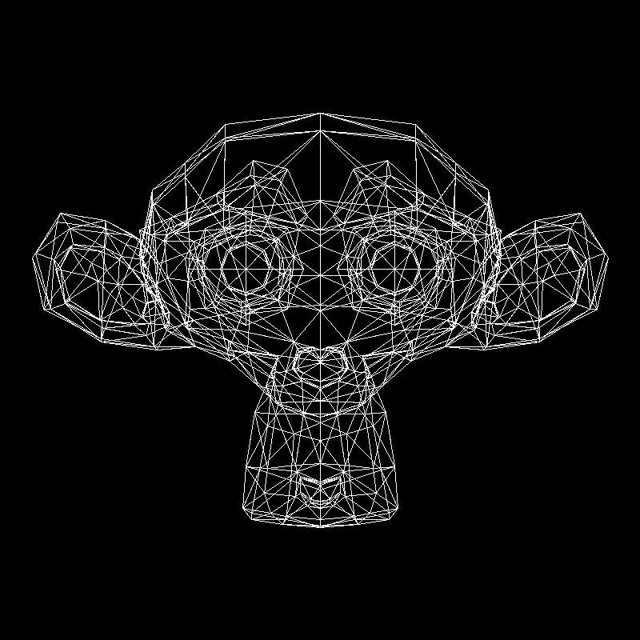
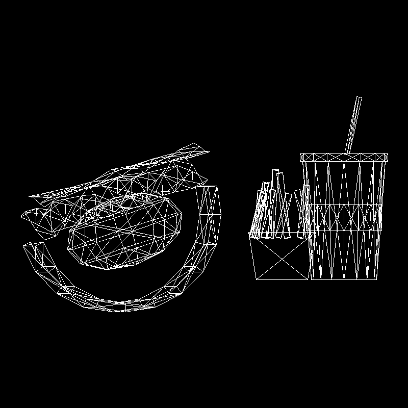

# Lab 4 - Zig: Carga de modelos

Carga un modelo `.obj` triangulado y lo dibuja en wireframe: se proyectan los
vértices (ortográfica, centrado y escalado) y se traza cada arista con
Bresenham. Genera una imagen PNG (Zig puro, sin dependencias).

## Resultados

Suzanne (el monito de Blender), `model.obj`:



Combo de Taco Bell modelado en Blender, `combo.obj`:



## Cómo correr

Requiere [Zig](https://ziglang.org/) 0.16.0.

```sh
zig build run                              # model.obj -> out.png
zig build run -- combo.obj                 # otro modelo -> out.png
zig build run -- combo.obj img/combo.png   # elegir archivo de salida
```

## Estructura

- `src/obj.zig` — parser de `v` / `f`.
- `src/canvas.zig` — buffer de píxeles y `drawLine`.
- `src/png.zig` — encoder PNG.
- `src/main.zig` — proyección y dibujo del wireframe.
